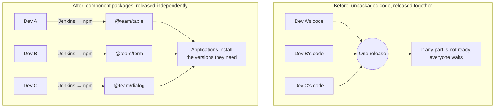

# Angular Component Packaging & Independent Releases — Citi (Case Study)

> From **one shared codebase where everyone's release blocked everyone else** to **reusable components that each developer packages and publishes independently.**


**Role:** Frontend Developer · **Company:** Citi, China · **Period:** Apr 2022 – Aug 2024

> ⚠️ This repository is a **write-up of my work**, not Citi's source code. All code, names and data belong to Citi. The diagrams and snippets below are simplified, generic illustrations of the approach.

---

## TL;DR

- **Problem 1 — duplicated work.** Common UI pieces (tables, forms, dialogs) were rewritten or copied for every new feature.
- **Problem 2 — blocked releases.** Developers' code was released together without packaging, so one person's unfinished or broken change could hold up everyone else's release.
- **What I did:** extracted the reusable pieces into **Angular component packages**; each developer packages and publishes the components they own to the **internal npm registry**, built and released through **Jenkins CI**.
- **Result:** components are **written once and reused** instead of rewritten, and **each person's release no longer affects anyone else's code**.

---

## Before → After



| | Before | After |
|---|---|---|
| Common UI (tables, forms, dialogs) | Rewritten or copied for each feature | Built once as a component, installed where needed |
| Releasing | Everyone's code shipped together | Each owner packages and publishes their own component |
| One person's change not ready | Blocks the whole release | Only that component waits; others ship |
| Build & publish | Manual | Jenkins CI → internal npm registry |

---

## What I did

### 1. Extract reusable components
- Identified UI that was being rebuilt repeatedly — **tables, forms and dialogs** — and pulled it out of feature code into standalone Angular components.
- Gave each component a **clear public API** (inputs, outputs, exported types), so it could be used without reading its internals.

```text
components/
├── table/
│   ├── src/              # component, module, public-api.ts
│   ├── package.json      # own name + version
│   └── ng-package.json
├── form/
└── dialog/
```
<sub>Generic illustration of the layout.</sub>

### 2. Package each component on its own
- Each component is built as its own **Angular library package** (Angular Package Format), with `@angular/*` as peer dependencies so apps don't load duplicate Angular versions.
- **Ownership follows the package:** the developer responsible for a component packages and releases it, without waiting for, or breaking, anyone else's work.

### 3. Publish through CI
- Packages are built and published to the **internal npm registry** through **Jenkins**, so a release is a pipeline run rather than a manual step on someone's machine.
- Applications install components with `npm install`, like any other dependency, and upgrade when they choose.
- Unit tests are written and run separately for each component.

---

## Impact

- **No more rewriting:** tables, forms and dialogs are developed once and reused across features.
- **No more blocked releases:** each developer's packaged component is published independently, so one person's change doesn't hold back or break anyone else's.

---

## What I learned

- **Packaging is about ownership as much as reuse.** Splitting code into packages let each person release on their own schedule.
- A component used by others needs a **stable public API** — every input and output is a promise.
- Automating build and publish in **CI** made releases repeatable and removed "works on my machine" problems.

---

## Tech

Angular · TypeScript · RxJS · Angular libraries (ng-packagr) · internal npm registry · Jenkins · unit testing
